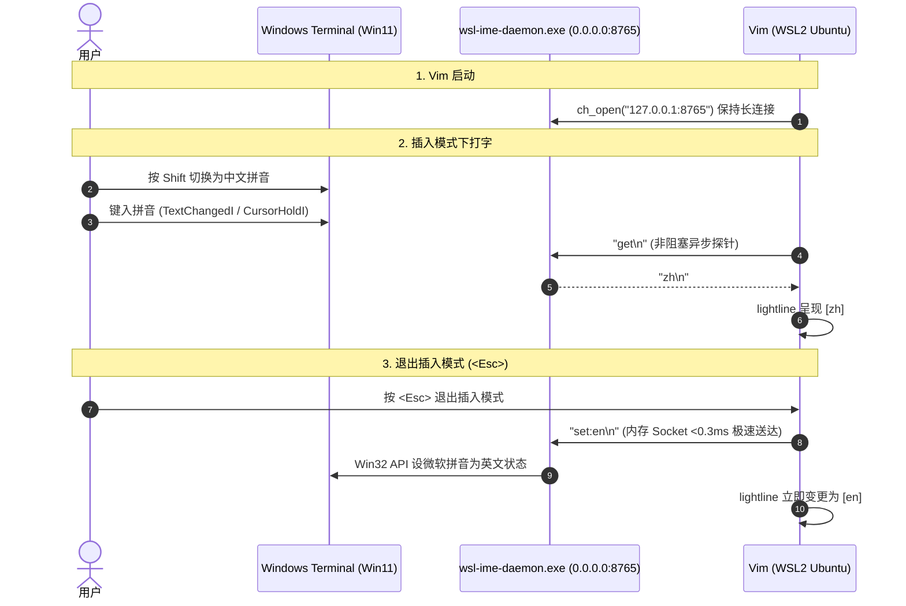

# WSL-IME Daemon (Windows 11)

[](LICENSE)
[](#)
[](#)

A high-performance, resident background daemon designed for **WSL2 + Windows Terminal + Vim/Neovim**. It provides instantaneous, sub-millisecond inspection and switching of the Windows 11 host input method (such as Microsoft Pinyin or Sogou) directly over a local loopback TCP socket, eliminating the severe lag caused by cross-system process spawning (`im-select.exe`).

---

## 目录 (Table of Contents)

- [背景与设计初衷 (Background)](#背景与设计初衷-background)
- [核心架构与通信协议 (Architecture & Protocol)](#核心架构与通信协议-architecture--protocol)
- [文件清单 (File Manifest)](#文件清单-file-manifest)
- [环境要求 (Prerequisites)](#环境要求-prerequisites)
- [编译指南 (Build & Compilation)](#编译指南-build--compilation)
- [启动与开机自启 (Running & Auto-Start)](#启动与开机自启-running--auto-start)
- [测试与延迟基准 (Testing & Verification)](#测试与延迟基准-testing--verification)
- [故障排查与 FAQ (Troubleshooting & FAQ)](#故障排查与-faq-troubleshooting--faq)
- [开源许可 (License)](#开源许可-license)

---

## 背景与设计初衷 (Background)

在 WSL2 环境下的终端编辑器（如 Vim/Neovim）中使用中文时，开发者通常有两个强烈诉求：
1. **插入模式（Insert）**：自由按 `Shift` 键无缝切换中英文输入，并希望状态栏（如 `lightline.vim`）实时显示 `[zh]` 或 `[en]`。
2. **普通模式（Normal）**：退出插入模式（按下 `<Esc>`）时，自动强制切回英文，避免在普通模式下移动光标（`h/j/k/l`）或执行命令（`dd`、`yy`）时误触中文拼音候选框。

### 传统跨进程方案的缺陷

社区传统做法通常是通过 WSL Interop 在每次按键事件中同步调用 Windows 可执行文件（如 `im-select.exe`）：

```
WSL (Linux) ===[ /init fork + WSL Interop + NT Process Exec (50~150ms) ]===> im-select.exe
```

- **严重卡顿**：WSL2 每次跨系统冷启动 Windows 进程开销高达 **50ms ~ 200ms**，在退出插入模式时会带来极其明显的“冻结停顿感”。
- **单一输入法适配缺陷**：传统 `im-select` 仅能切换键盘布局（`HKL` 1033 vs 2052）。对于仅安装了微软拼音、依靠按 `Shift` 切换内部中英状态的用户，`im-select` 无法感知或修改其转换状态。

### 本项目的解决方案

`wsl-ime-daemon` 在 Windows 端常驻运行一个极轻量（内存仅 3~5MB）的 Socket 守护服务：

```
WSL Vim =======[ 127.0.0.1:8765 TCP (<0.5ms) ]=======> wsl-ime-daemon.exe (Win32 Imm32 API)
```

- **0 冷启动开销**：TCP 环路传输 4~6 字节指令，耗时 **< 0.5ms**，完全零卡顿。
- **精准控制微软拼音**：通过 Win32 `WM_IME_CONTROL` (`IMC_GETOPENSTATUS` / `IMC_SETOPENSTATUS` / `IMC_SETCONVERSIONMODE`) 和 `GetGUIThreadInfo` 精确检测并控制 Windows Terminal 前台输入法状态。

---

## 核心架构与通信协议 (Architecture & Protocol)

### 架构时序图



### TCP 通信指令规范 (Protocol Specification)

服务默认监听 `0.0.0.0:8765`。客户端使用 ASCII 编码以 `\n` 或 `\r\n` 结尾发送指令：

| 指令 (Command) | 响应 (Response) | 说明 |
| :--- | :--- | :--- |
| `ping` | `pong` | 连通性测试与延迟探测 |
| `get` | `zh` 或 `en` | 获取当前活动窗口（Windows Terminal）的输入法状态 |
| `set:en` | `ok` | 强制将当前活动窗口输入法切回英文状态 |
| `set:zh` | `ok` | 强制将当前活动窗口输入法切换为中文状态 |
| `toggle` | `zh` 或 `en` | 翻转输入法状态并返回新状态 |
| `stop` | `ok` | 停止守护服务并安全退出进程 |
| `quit` | *(断开连接)* | 关闭当前客户端连接会话 |

---

## 文件清单 (File Manifest)

| 文件名 | 职责说明 |
| :--- | :--- |
| [`wsl-ime-daemon.cs`](file:///home/laukalin/dotfiles/bin/hosts/win11/wsl-ime-daemon.cs) | 守护服务核心源码（C# 单文件，内置 Win32 API 与高并发 TCP 服务） |
| [`build.bat`](file:///home/laukalin/dotfiles/bin/hosts/win11/build.bat) | Windows 批处理编译脚本（自动适配 WSL UNC 路径，调用自带 `csc.exe` 编译） |
| [`build.sh`](file:///home/laukalin/dotfiles/bin/hosts/win11/build.sh) | Linux/WSL 编译脚本（可在 Ubuntu 终端下直接调用 Windows 编译器） |
| [`start-daemon.bat`](file:///home/laukalin/dotfiles/bin/hosts/win11/start-daemon.bat) | Windows 后台启动脚本（含健康检查与错误现场日志捕获） |
| [`start-daemon.ps1`](file:///home/laukalin/dotfiles/bin/hosts/win11/start-daemon.ps1) | PowerShell 启动脚本（适合在 Windows Terminal 中运行，色彩高亮诊断） |
| [`stop-daemon.bat`](file:///home/laukalin/dotfiles/bin/hosts/win11/stop-daemon.bat) | 安全停止后台常驻服务脚本 |
| [`install-startup.bat`](file:///home/laukalin/dotfiles/bin/hosts/win11/install-startup.bat) | 一键安装开机自启快捷方式到 Windows Startup 目录 |
| [`sign-binary.bat`](file:///home/laukalin/dotfiles/bin/hosts/win11/sign-binary.bat) | Authenticode 代码签名批处理包装脚本（双击一键执行代码签名） |
| [`sign-binary.ps1`](file:///home/laukalin/dotfiles/bin/hosts/win11/sign-binary.ps1) | 代码签名核心脚本（自动创建/信任证书、嵌入数字签名并解除网络锁定） |
| [`add-firewall-rule.bat`](file:///home/laukalin/dotfiles/bin/hosts/win11/add-firewall-rule.bat) | 防火墙一键放行脚本（自动申请管理员权限放行 TCP 8765 端口） |
| [`test-daemon.py`](file:///home/laukalin/dotfiles/bin/hosts/win11/test-daemon.py) | WSL 端通信测试与延迟测速脚本 |
| [`LICENSE`](file:///home/laukalin/dotfiles/bin/hosts/win11/LICENSE) | MIT 开源许可证 |
| [`README.md`](file:///home/laukalin/dotfiles/bin/hosts/win11/README.md) | 本工程完整说明文档 |

---

## 环境要求 (Prerequisites)

- **宿主系统**：Windows 10 / Windows 11
- **子系统**：WSL2（Ubuntu 或任意 Linux 发行版）
- **编译工具**：Windows 自带的 `.NET Framework 4.0+` 编译器 `csc.exe`（系统自带，无需安装任何额外开发工具）
- **终端宿主**：Windows Terminal、VS Code 终端或原生 Console

---

## 编译指南 (Build & Compilation)

### 方式 1：Windows 资源管理器 / CMD（推荐）

在 Windows 文件资源管理器中进入本目录，双击运行 [`build.bat`](file:///home/laukalin/dotfiles/bin/hosts/win11/build.bat)。  
脚本会自动调用：
```cmd
C:\Windows\Microsoft.NET\Framework64\v4.0.30319\csc.exe /target:winexe /optimize+ /out:wsl-ime-daemon.exe wsl-ime-daemon.cs
```
并在编译成功后自动将二进制复制到 `%LOCALAPPDATA%\wsl-ime\wsl-ime-daemon.exe`。

### 方式 2：WSL 终端直接编译

在 WSL 终端中运行：
```bash
./bin/hosts/win11/build.sh
```

---

## 启动与开机自启 (Running & Auto-Start)

### 1. 启动服务

- **批处理启动**：双击运行 [`start-daemon.bat`](file:///home/laukalin/dotfiles/bin/hosts/win11/start-daemon.bat)。
- **PowerShell 启动**：在 Windows 终端运行 `.\start-daemon.ps1`。

### 2. 设置 Windows 开机静默自启（推荐）

双击运行 [`install-startup.bat`](file:///home/laukalin/dotfiles/bin/hosts/win11/install-startup.bat)。  
脚本会在 `%APPDATA%\Microsoft\Windows\Start Menu\Programs\Startup` 中创建快捷方式，开机登录后自动静默就绪，**日常完全无需手动启动或停止**。

### 3. 停止服务

如需升级或停止，双击运行 [`stop-daemon.bat`](file:///home/laukalin/dotfiles/bin/hosts/win11/stop-daemon.bat)。

---

## 代码签名与发布者验证 (Authenticode Code Signing)

为消除 Windows 资源管理器与 SmartScreen 的“无法验证发布者”黄色安全警告，本项目支持基于本地专用数字证书的原生 Authenticode 签名。

### 1. 签名特性
- **自动流水线（编译即签名）**：运行 [`build.bat`](file:///home/laukalin/dotfiles/bin/hosts/win11/build.bat) 编译完成后，会自动调用 [`sign-binary.ps1`](file:///home/laukalin/dotfiles/bin/hosts/win11/sign-binary.ps1) 为生成的可执行文件签名。
- **发布者证书创建与信任**：首次签名时，脚本自动在 Windows 证书库（`Cert:\CurrentUser\My`）创建专属代码签名证书（发布者：`LAU Kalin`，有效期 10 年），并自动将其信任至「受信任的根证书颁发机构」与「受信任的发布者」（首次运行系统将弹出一次确认安装框）。
- **解除网络锁定 (Unblock)**：自动调用 `Unblock-File` 清除 WSL UNC 共享路径带来的 `Zone.Identifier` 标记，彻底杜绝 `.bat` 和 `.exe` 弹窗。

### 2. 手动执行签名
若需要手动重新为二进制签名，可直接运行：
```cmd
sign-binary.bat
```
签名成功后，右键点击 `wsl-ime-daemon.exe` -> **属性** -> **数字签名**，状态显示为：
> **「此数字签名正常。」**  
> **签名者姓名：`LAU Kalin`**

---

## 测试与延迟基准 (Testing & Verification)

在 WSL 终端中运行测试脚本进行验证：

```bash
# 1. 连通性测试 (ping)
python3 bin/hosts/win11/test-daemon.py ping
# 输出示例: [ping] -> pong (via 127.0.0.1:8765 in 0.38ms)

# 2. 查询当前输入法状态
python3 bin/hosts/win11/test-daemon.py get
# 输出示例: [get] -> zh (via 127.0.0.1:8765 in 0.41ms)

# 3. 强制切换为英文
python3 bin/hosts/win11/test-daemon.py set:en
# 输出示例: [set:en] -> ok (via 127.0.0.1:8765 in 0.35ms)
```

---

## 故障排查与 FAQ (Troubleshooting & FAQ)

### Q1: `test-daemon.py` 提示 `[ERROR] timed out` 或 `Connection refused`

1. **检查进程是否在运行**：
   在 Windows CMD/PowerShell 中执行：
   ```powershell
   tasklist | findstr wsl-ime-daemon
   ```
   若无进程，请运行 `start-daemon.bat` 启动。
2. **Windows 防火墙放行**：
   WSL2 在镜像网络（`networkingMode=Mirrored`）下，入站连接受 Windows 防火墙规则约束。右键以管理员权限运行 [`add-firewall-rule.bat`](file:///home/laukalin/dotfiles/bin/hosts/win11/add-firewall-rule.bat)，或在管理员 PowerShell 中执行：
   ```powershell
   New-NetFirewallRule -DisplayName "WSL-IME" -Direction Inbound -LocalPort 8765 -Protocol TCP -Action Allow
   ```

### Q2: 如何查看守护进程的运行日志？

程序运行日志保存在 Windows 用户目录：
```cmd
%LOCALAPPDATA%\wsl-ime\daemon.log
```
在 WSL 中可直接查看：
```bash
tail -f "/mnt/c/Users/$USER/AppData/Local/wsl-ime/daemon.log"
```

### Q3: 为什么 `build.bat` 双击曾报错 `CS2001: 未能找到源文件`？

Windows `cmd.exe` 不原生支持网络 UNC 路径（如 `\\wsl.localhost\...`）作为当前工作目录。本项目在所有批处理脚本中均使用了 `pushd "%~dp0"`，由 Windows 自动挂载虚拟驱动器盘符（如 `Z:`），彻底解决了该限制。

---

## 开源许可 (License)

本项目采用 [MIT License](LICENSE) 开源许可证。
欢迎自由修改、分发与集成到个人的 dotfiles 配置中。
